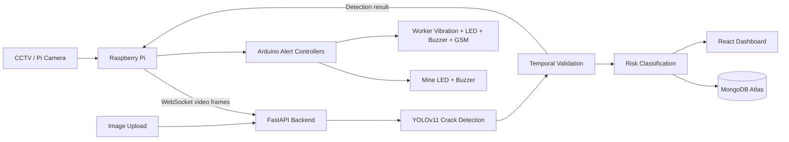

# RockSense — AI-Based Rockfall Prediction and Mine Safety Monitoring


**Project Code: `DK6BYV`**

RockSense is an AI- and IoT-assisted mine safety monitoring prototype designed to identify slope cracks and assess potential rockfall risk in open-pit mining environments. It combines camera-based crack detection, machine-learning risk classification, a live monitoring dashboard, and connected alert hardware to help mine operators respond to potentially unsafe conditions.

> **Disclaimer:** RockSense is a prototype intended for development and demonstration. It is not a certified mine-safety system and must not replace professional inspections, approved warning systems, or established evacuation procedures.

---

## Overview

Rockfall and slope failure can endanger workers, equipment, and mining operations. RockSense aims to support earlier identification of visible slope damage by analysing images and camera streams, estimating risk, and communicating alerts to the monitoring interface and connected devices.

The system supports two monitoring paths:

- **Image analysis:** An image is submitted to the FastAPI backend. YOLO-based detection identifies candidate crack regions, and the risk-classification service estimates a risk level.
- **Live monitoring:** A Raspberry Pi captures camera frames and streams them to the backend over WebSockets. The backend performs crack detection and temporal validation before returning confirmed detection information to the Pi.

Risk levels are represented as **LOW**, **MEDIUM**, and **HIGH**.

## Key Features

- **AI-based crack detection** using an Ultralytics YOLOv11 model.
- **Risk classification** using the configured Keras model in the backend image-analysis pipeline and a Random Forest model in the Raspberry Pi deployment.
- **Temporal validation** of live detections using a rolling 15-second window. The streaming configuration confirms a crack when it appears in more than 60% of frames in the window.
- **Live camera streaming** from a Raspberry Pi to the backend and browser dashboard using WebSockets.
- **Mine alerts** through an Arduino-controlled LED and buzzer.
- **Worker alerts** through a wearable Arduino device with vibration, buzzer, LED, and GSM-based SMS support.
- **Monitoring dashboard** with live monitoring, image analysis, detection history, weather intelligence, mine-map visualisation, and device-health views.
- **Worker and admin pages** for worker information and system management.
- **MongoDB persistence** for application records and monitoring data.

## System Architecture



### Live-stream processing flow

1. The Raspberry Pi captures frames from the connected camera.
2. Frames are sent to the backend through the `/ws/pi-frame` WebSocket connection.
3. The backend runs YOLOv11 inference to detect candidate crack regions.
4. A rolling temporal buffer evaluates detections over 15 seconds.
5. A detection is marked as confirmed when cracks are present in more than 60% of frames in the configured window.
6. The backend sends the confirmed result to the Raspberry Pi and broadcasts live frames/status to dashboard clients.
7. The Pi-side risk model estimates the risk category and can issue the configured Arduino alert commands.
8. The dashboard displays the stream, detection state, and risk information.

The thresholds and streaming parameters are configurable in the backend streaming module.

## Technology Stack

| Layer | Technologies |
|---|---|
| Frontend | React 19, Vite, React Router, CSS |
| Visualisation | Three.js, React Three Fiber, Leaflet, Recharts |
| Backend | Python, FastAPI, Uvicorn |
| Computer vision | YOLOv11, Ultralytics, OpenCV, Pillow |
| Machine learning | TensorFlow / Keras, scikit-learn, Random Forest |
| Database | MongoDB Atlas, Motor, Beanie ODM |
| Real-time communication | WebSockets |
| Edge device | Raspberry Pi, Pi Camera |
| Hardware alerts | Arduino Uno, Arduino Nano, GSM module, LED, buzzer, vibration motor |
| Weather | OpenWeather API integration |

## Repository Structure

```text
ai_rockfall/
├── backend/
│   ├── app/
│   │   ├── routers/             # API routes: inference, camera, workers, weather, etc.
│   │   ├── services/            # YOLO, risk, weather, and Arduino services
│   │   ├── main.py              # FastAPI application entry point
│   │   ├── config.py            # Application and model configuration
│   │   ├── database.py          # MongoDB connection
│   │   └── models.py            # Database document models
│   ├── models/                  # YOLO and Keras model files
│   ├── requirements.txt
│   └── run_server.bat
├── frontend/
│   ├── src/
│   │   ├── components/          # Dashboard and visualisation components
│   │   ├── context/              # Shared frontend state and WebSocket context
│   │   ├── pages/                # Monitoring, analysis, map, history, admin, etc.
│   │   └── App.jsx
│   ├── package.json
│   └── run_frontend.bat
├── raspberrypi_rocksence/
│   ├── pi_client.py              # Raspberry Pi streaming client
│   ├── rocksense_pi.py           # Pi-side RockSense application
│   ├── rocksense_random_forest.pkl
│   ├── Yolo11.pt
│   └── requirements_pi.txt
├── raspberry_pi/                 # Modular Raspberry Pi implementation
├── arduino/
│   ├── mine_alert/               # Mine alarm controller
│   └── worker_tracking/          # Worker wearable and GSM alert controller
├── SETUP.md
├── STREAMING_SETUP.md
├── TECH_STACK.md
├── CIRCUIT_AI_HARDWARE_SETUP.md
└── START_SYSTEM.bat
```

## Requirements

### Software

- Python 3.10 or newer
- Node.js LTS and npm
- Git
- MongoDB Atlas database or a compatible MongoDB deployment
- Windows for the supplied `.bat` launcher scripts (manual commands can also be used on other platforms)

### Optional hardware for the complete IoT setup

- Raspberry Pi 4 or Raspberry Pi 5
- Compatible Raspberry Pi camera or USB camera
- Arduino Uno for the mine alert unit
- Arduino Nano for the worker alert unit
- GSM module such as SIM800L / SIM900
- LED, buzzer, vibration motor, and required power components

The web application and backend can be explored without connecting the optional alert hardware, but hardware-specific functions will not be available.

---

## Getting Started

### 1. Clone the repository

```bash
git clone https://github.com/sudharshan-s-1286/ai_rockfall.git
cd ai_rockfall
```

### 2. Configure and start the backend

Create and activate a virtual environment.

**Windows (PowerShell):**

```powershell
cd backend
python -m venv .venv
.\.venv\Scripts\Activate.ps1
```

**Linux / macOS:**

```bash
cd backend
python3 -m venv .venv
source .venv/bin/activate
```

Install the Python dependencies:

```bash
pip install -r requirements.txt
```

#### Configure environment variables and model paths

Create a `.env` file inside the `backend/` directory. Set the values for your own environment:

```env
MONGODB_URI=mongodb+srv://<username>:<password>@<cluster-url>/
MONGODB_DB_NAME=rocksense_db

# Use absolute paths to the model files in your cloned repository.
YOLO_PATH=<absolute-path-to-repository>/backend/models/Yolo11.pt
KERAS_MODEL_PATH=<absolute-path-to-repository>/backend/models/Model_keras/keras_model.h5
LABELS_PATH=<absolute-path-to-repository>/backend/models/Model_keras/labels.txt

# Optional: required for live weather data.
WEATHER_API_KEY=<your-openweather-api-key>
WEATHER_LAT=<mining-site-latitude>
WEATHER_LON=<mining-site-longitude>
```

Replace every placeholder with a valid value. Ensure the model paths point to files that exist in your local clone. Keep the `.env` file private and do not commit database credentials or API keys.

Start the backend from the `backend/` directory:

```bash
uvicorn app.main:app --reload --host 0.0.0.0 --port 8000
```

The API documentation is available at:

- Swagger UI: [http://localhost:8000/docs](http://localhost:8000/docs)
- ReDoc: [http://localhost:8000/redoc](http://localhost:8000/redoc)

### 3. Configure and start the frontend

Open a second terminal:

```bash
cd frontend
npm install
npm run dev
```

Open the Vite development URL shown in the terminal. The default address is [http://localhost:5173](http://localhost:5173).

### 4. Windows launcher (optional)

After configuring the backend environment and installing frontend dependencies, you can launch both applications from the repository root:

```bat
START_SYSTEM.bat
```

This script starts the backend and frontend in separate terminal windows.

---

## Raspberry Pi Live Streaming

The Raspberry Pi client streams camera frames to the backend. First, make sure the backend is running and reachable over the same network.

On Raspberry Pi OS, install the camera support package if you are using a CSI Pi Camera:

```bash
sudo apt update
sudo apt install -y python3-picamera2
```

Install the Pi-side Python requirements:

```bash
cd raspberrypi_rocksence
python3 -m venv .venv
source .venv/bin/activate
pip install -r requirements_pi.txt
```

Run the streaming client, replacing the example address with the laptop/server IP address:

```bash
python3 pi_client.py \
  --server ws://<BACKEND_IP>:8000/ws/pi-frame \
  --headless \
  --ard-port /dev/ttyUSB0 \
  --gsm-port /dev/ttyUSB1 \
  --fps 8 \
  --quality 65
```

Adjust the serial ports to match the devices connected to your Raspberry Pi. The camera, Arduino, and GSM modules are optional for running the browser dashboard, but required for the corresponding hardware workflow.

For the detailed Pi setup, CLI options, streaming architecture, and troubleshooting, see [STREAMING_SETUP.md](STREAMING_SETUP.md) and [raspberrypi_rocksence/SETUP_GUIDE.txt](raspberrypi_rocksence/SETUP_GUIDE.txt).

## Hardware Alert Behaviour

| Device | Expected command | Action |
|---|---|---|
| Arduino Uno — mine alert | `HIGH_RISK` | Activates mine alert LED and buzzer |
| Arduino Uno — mine alert | `STOP` | Clears the mine alert |
| Arduino Nano — worker unit | `WORKER_ALERT` | Activates vibration motor, LED, buzzer, and sends an SMS once for the alert event |
| Arduino Nano — worker unit | `WORKER_CLEAR` | Clears the worker alert |

Before using the worker GSM unit, configure the alert phone number in `arduino/worker_tracking/worker_tracking.ino`. Check the wiring and power requirements in [CIRCUIT_AI_HARDWARE_SETUP.md](CIRCUIT_AI_HARDWARE_SETUP.md).

## Useful API and Stream Endpoints

| Endpoint | Purpose |
|---|---|
| `POST /inference/detect` | Upload an image for crack detection and risk assessment |
| `GET /docs` | Interactive API documentation |
| `GET /redoc` | Alternative API documentation |
| `/ws/pi-frame` | WebSocket endpoint for Raspberry Pi camera frames |
| `/ws/live-feed` | WebSocket endpoint for browser live-feed clients |
| `GET /api/pi-stream/status` | Pi stream connection and processing status |
| `GET /api/pi-stream/snapshot` | Latest captured frame |
| `GET /api/pi-stream/mjpeg` | MJPEG stream fallback |
| `GET /api/pi-stream/detections` | Recent stream detections |

The live-stream endpoints are part of the Pi streaming module. Refer to the API documentation and streaming setup guide for the current response formats.

## Additional Documentation

- [Setup Guide](SETUP.md) — general installation and startup instructions.
- [Technology Stack](TECH_STACK.md) — framework, AI, database, and hardware stack.
- [Streaming Setup](STREAMING_SETUP.md) — detailed Raspberry Pi camera streaming workflow.
- [Hardware Setup](CIRCUIT_AI_HARDWARE_SETUP.md) — component list and wiring information.
- [Raspberry Pi Setup Guide](raspberrypi_rocksence/SETUP_GUIDE.txt) — Pi installation and operation guide.

## Security and Deployment Notes

This repository is a development prototype. Before exposing it to a network or using it beyond a controlled demonstration:

- Replace any credentials or API keys committed in source configuration and rotate any real keys that have been exposed.
- Store secrets in environment variables or a private `.env` file; never commit them.
- Replace demo authentication and default credentials with a production-grade authentication and password-hashing design.
- Review database TLS certificate validation, CORS rules, access controls, and device-command authorization.
- Validate the complete camera-to-alert pipeline under controlled conditions before relying on it.

---

**RockSense — AI-assisted slope monitoring for safer mining operations.**
